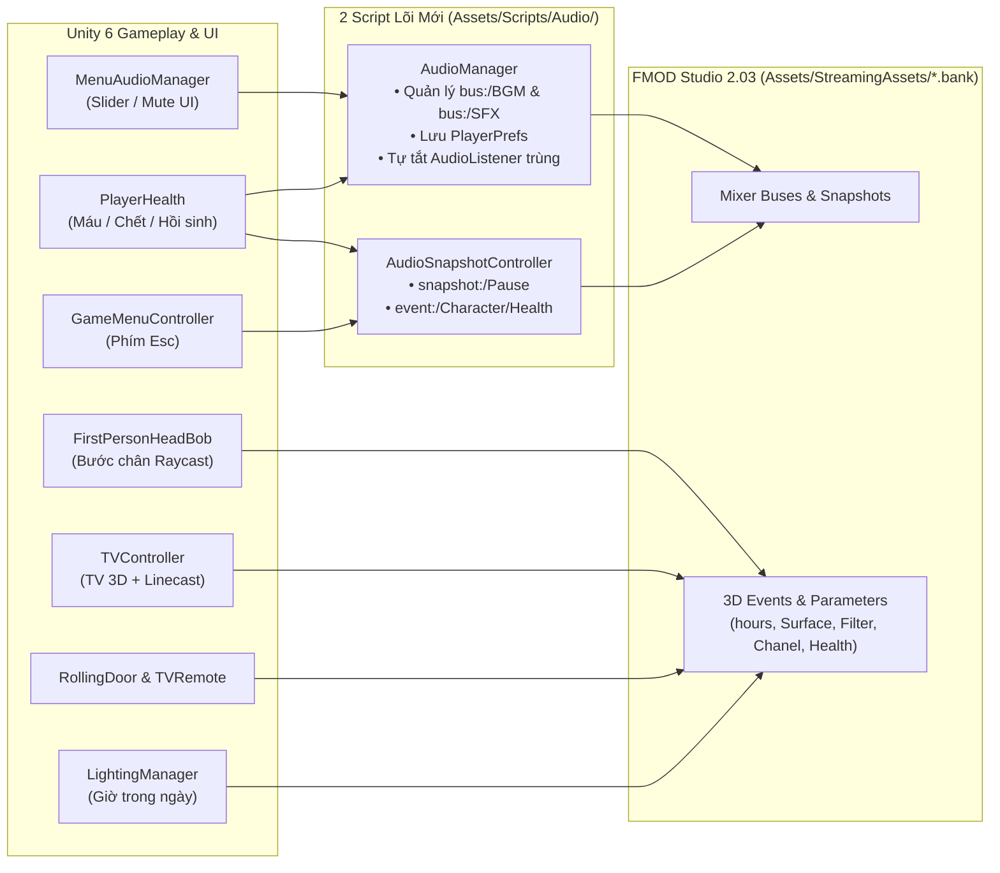

# Tài Liệu Hệ Thống Công Nghệ Âm Thanh (Unity 6 + FMOD Studio)

Tài liệu này tổng hợp kiến trúc và toàn bộ công nghệ âm thanh đang có trong dự án, viết theo hướng **ngắn gọn – trực quan – dễ trình bày trước hội đồng**.

---

## 1. Kiến trúc tổng thể

---

## 2. Bảng tổng hợp công nghệ âm thanh (Dùng cho thuyết trình)

| # | Công nghệ âm thanh | Script & File liên quan | Giải thích ngắn gọn cơ chế (2–3 câu) |
|---|---|---|---|
| 1 | **FMOD Bus Mixing & Lưu cài đặt** | [`AudioManager.cs`](file:///c:/Users/phu/game%20project/3d%20rpgame/Assets/Scripts/Audio/AudioManager.cs), [`MenuAudioManager.cs`](file:///c:/Users/phu/game%20project/3d%20rpgame/Assets/Scenes/script/MenuAudioManager.cs) | Toàn bộ âm thanh FMOD được gom qua 2 Bus chính là `bus:/BGM` (nhạc nền) và `bus:/SFX` (hiệu ứng). Khi người chơi kéo Slider hoặc bấm Mute, âm lượng được gửi trực tiếp vào FMOD Bus và lưu xuống `PlayerPrefs`, đồng thời tự động tắt `AudioListener` thừa để tránh xung đột. |
| 2 | **Dynamic Mixing: Pause Snapshot** | [`AudioSnapshotController.cs`](file:///c:/Users/phu/game%20project/3d%20rpgame/Assets/Scripts/Audio/AudioSnapshotController.cs), [`GameMenuController.cs`](file:///c:/Users/phu/game%20project/3d%20rpgame/Assets/Scenes/script/GameMenuController.cs) | Khi bấm `Esc` mở Pause Menu, game kích hoạt `snapshot:/Pause` của FMOD để tự động hạ âm lượng các kênh hiệu ứng, giúp không gian tĩnh lại khi đang ở màn hình tạm dừng mà không cần dừng từng âm thanh thủ công. |
| 3 | **Low-Health Heartbeat & Filter** | [`AudioSnapshotController.cs`](file:///c:/Users/phu/game%20project/3d%20rpgame/Assets/Scripts/Audio/AudioSnapshotController.cs), [`PlayerHealth.cs`](file:///c:/Users/phu/game%20project/3d%20rpgame/Assets/Scripts/HealthSystem/PlayerHealth.cs) | Duy trì một Persistent Event `event:/Character/Health` nhận tham số `"Health"` (`0..100`). Khi máu xuống dưới `25%`, FMOD tự động phát vòng lặp tiếng nhịp tim và kích hoạt `snapshot:/Health Low` (lọc Lowpass và giảm âm lượng môi trường/vũ khí); khi tử trận, tham số trả về `100` để tắt nhịp tim. |
| 4 | **Nhạc nền động theo Chu kỳ Ngày/Đêm** | [`LightingManager.cs`](file:///c:/Users/phu/game%20project/3d%20rpgame/Assets/LightingManager_Assets/LightingManager.cs) | Khi game chạy, `LightingManager` tạo `event:/daynight` và truyền liên tục biến `TimeOfDay` (`0..24`) vào Parameter `"hours"` của FMOD. Nhờ đó bản nhạc nền và không khí tự động biến chuyển mượt mà theo từng khung giờ sáng – trưa – chiều – tối. |
| 5 | **Âm thanh 3D & Cản âm vật lý (Occlusion)** | [`TVController.cs`](file:///c:/Users/phu/game%20project/3d%20rpgame/Assets/Scenes/script/TVController.cs) | TV cập nhật tọa độ 3D liên tục qua `set3DAttributes` để âm thanh to/nhỏ, trái/phải theo hướng quay đầu của người chơi; điều khiển kênh qua Parameter `"Chanel"` và `"Volume"`. Đồng thời, hàm `CheckOcclusion()` bắn tia `Physics.Linecast` kiểm tra tường chắn và dùng `Mathf.Lerp` làm mượt Parameter `"Filter"` (`0..1`) giúp tiếng TV đục đi tự nhiên khi đứng sau tường. |
| 6 | **Bước chân 3D theo Bề mặt (Surface)** | [`FirstPersonHeadBob.cs`](file:///c:/Users/phu/game%20project/3d%20rpgame/Assets/Easy%20Weapons/Scripts/Sample/FirstPersonHeadBob.cs) | Mỗi bước chân, script bắn 1 tia `Raycast` xuống đất đọc `Tag` (`Ground`, `Grass`, `Wood`, `water`), ánh xạ sang giá trị `0..3` và truyền vào Parameter `"Surface"` của `event:/Character/Player Footsteps` tại vị trí 3D của nhân vật. |
| 7 | **Âm thanh bám vật thể & Tương tác 3D** | [`RollingDoor.cs`](file:///c:/Users/phu/game%20project/3d%20rpgame/Assets/Scenes/script/RollingDoor.cs), [`TVRemote.cs`](file:///c:/Users/phu/game%20project/3d%20rpgame/Assets/Scenes/script/TVRemote.cs) | Cửa cuốn dùng `RuntimeManager.PlayOneShotAttached` để nguồn âm di chuyển theo cánh cửa đang trượt lên/xuống; chiếc Remote dùng `PlayOneShot` tại tọa độ nút bấm; hệ thống Hurt/Die dùng FMOD ưu tiên kèm fallback `AudioClip` Unity. |
| 8 | **Va chạm vật lý & Random Pitch** | [`SurfaceInteractionAudio.cs`](file:///c:/Users/phu/game%20project/3d%20rpgame/Assets/Scenes/script/SurfaceInteractionAudio.cs) | Gắn trên vỏ đạn và vết đạn: khi va chạm vật lý (`OnCollisionEnter`), script tra cứu Tag bề mặt (hoặc fallback `"Any"`/`"Untagged"`), chọn ngẫu nhiên clip, biến thiên nhẹ cao độ (Pitch) và giới hạn bằng `collisionCooldown` để tránh vỡ tiếng khi vỏ đạn nảy liên tiếp. |

---

## 3. Hướng dẫn thiết lập & Kiểm thử trên `demo.unity`

### Bước 1: Liên kết lại FMOD Project trong Unity
1. Mở Unity Editor → menu **FMOD → Edit Settings**.
2. Ở mục **Studio Project Path**, chọn đường dẫn tới:
   `C:\Users\phu\Documents\SFX_Resources\Examples.fspro`
3. Nhấn **FMOD → Refresh Banks** và xác nhận Console không còn báo lỗi `DllNotFoundException: fmodstudioL`.

*(Tùy chọn trong FMOD Studio nếu muốn hiệu ứng Pause / Health Low rõ rệt hơn trên nhạc `daynight` và `television`)*:
- Mở cửa sổ **Mixer (`Ctrl+2`) → Snapshots**:
  - Ở snapshot **`Pause`**: giảm thêm Volume của bus `BGM` (khoảng `-12 dB`) và bus `SFX` (khoảng `-15 dB`).
  - Ở snapshot **`Health Low`**: giảm thêm Volume của bus `BGM` (khoảng `-10 dB`) và `SFX` (khoảng `-8 dB`).
- Lưu (`Ctrl+S`), bấm **Build (`F7`)**, rồi trong Unity bấm **FMOD → Refresh Banks**.

### Bước 2: Gắn 2 script lõi vào `Assets/Scenes/demo.unity`
1. Mở scene **`Assets/Scenes/demo.unity`** (scene `main.unity` được giữ nguyên hoàn toàn).
2. Tạo một GameObject rỗng đặt tên **`AudioSystem`**, gắn 2 component:
   - `AudioManager`
   - `AudioSnapshotController`

### Bước 3: Bấm `Play ▶` và kiểm thử 4 bài test
1. **Pause Snapshot (`[Esc]`):** Bấm `Esc` mở Menu → kiểm tra `AudioSnapshotController` kích hoạt `snapshot:/Pause`, thử kéo Slider BGM/SFX qua `MenuAudioManager` → `AudioManager`.
2. **Low-Health Heartbeat (`[H]`):** Bấm `[H]` nhiều lần để hạ máu xuống **dưới 25%** → nghe tiếng tim đập (`event:/Character/Health`) và hiệu ứng lọc âm `Health Low`; bấm `[J]` hồi máu hoặc `[K]` chết → nhịp tim tự tắt.
3. **Cản âm 3D trên TV (`[X]` / `[F]`):** Đứng trước TV bấm `X` bật TV, đổi kênh bằng `F`, sau đó đi ra sau bức tường → nghe tiếng TV bị lọc đục mượt mà nhờ tham số `"Filter"`.
4. **Bước chân theo Bề mặt:** Di chuyển qua các bề mặt cỏ (`Grass`), gỗ (`Wood`), đất (`Ground`) → kiểm tra tiếng bước chân thay đổi theo chất liệu nhờ tham số `"Surface"`.

---

## 4. Ghi chú dọn dẹp dự án (Mức 1)

- **Đã xóa an toàn các file/thư mục 0 tham chiếu:**
  - Tài liệu cũ sai lệch: `AUDIO_IMPLEMENTATION_REPORT.md`, `AUDIO_SETUP_GUIDE.md`
  - File trùng/log tạm: `3d-rpgame.slnx`, `fmod_editor.log`
  - Gói mẫu/backup không dùng: `Assets/TutorialInfo/`, `Assets/Readme.asset`, `Assets/_Recovery/`, `Assets/Easy Weapons/Scripts/Easy Camera Shake/Demo/`, `Assets/Easy Weapons/Scripts/Spawner.cs`, `Assets/Easy Weapons/Scripts/SlowMotion.cs`, `Assets/Easy Weapons/Demo/`, `Assets/LightingManager_Assets/ExampleScene/`
- **Đã bảo vệ giữ nguyên 5 file `.mp3` đang được `main.unity` tham chiếu:**
  - `Assets/Am_thanh_banh_rang_kim_loai_khong_lo_quay-www_tiengdong_com.mp3`
  - 4 file `.mp3` tiếng Việt trong `Assets/Plugins/FMOD/Resources/`
  *(Không xóa các file này để tránh gây Missing AudioClip trong `main.unity`.)*
- **Các file code mới tạo & tối ưu:**
  - Mới: [`AudioManager.cs`](file:///c:/Users/phu/game%20project/3d%20rpgame/Assets/Scripts/Audio/AudioManager.cs), [`AudioSnapshotController.cs`](file:///c:/Users/phu/game%20project/3d%20rpgame/Assets/Scripts/Audio/AudioSnapshotController.cs)
  - Đã sửa lỗi/tối ưu/chú thích rõ ràng: [`MenuAudioManager.cs`](file:///c:/Users/phu/game%20project/3d%20rpgame/Assets/Scenes/script/MenuAudioManager.cs), [`GameMenuController.cs`](file:///c:/Users/phu/game%20project/3d%20rpgame/Assets/Scenes/script/GameMenuController.cs), [`PlayerHealth.cs`](file:///c:/Users/phu/game%20project/3d%20rpgame/Assets/Scripts/HealthSystem/PlayerHealth.cs), [`FirstPersonHeadBob.cs`](file:///c:/Users/phu/game%20project/3d%20rpgame/Assets/Easy%20Weapons/Scripts/Sample/FirstPersonHeadBob.cs), [`TVController.cs`](file:///c:/Users/phu/game%20project/3d%20rpgame/Assets/Scenes/script/TVController.cs), [`RollingDoor.cs`](file:///c:/Users/phu/game%20project/3d%20rpgame/Assets/Scenes/script/RollingDoor.cs), [`TVRemote.cs`](file:///c:/Users/phu/game%20project/3d%20rpgame/Assets/Scenes/script/TVRemote.cs), [`LightingManager.cs`](file:///c:/Users/phu/game%20project/3d%20rpgame/Assets/LightingManager_Assets/LightingManager.cs), [`SurfaceInteractionAudio.cs`](file:///c:/Users/phu/game%20project/3d%20rpgame/Assets/Scenes/script/SurfaceInteractionAudio.cs).
